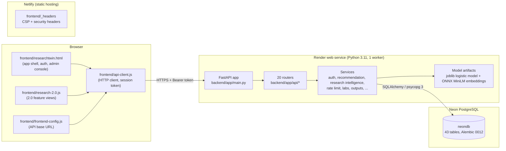

# ResearchTwin Architecture

ResearchTwin connects students with faculty researchers. The backend computes recommendations and enforces every access rule; the browser frontend is a client that renders what the API returns.

## Components

| Layer | Technology | Source |
|---|---|---|
| Frontend | Static HTML and vanilla JavaScript, no build step | `frontend/` |
| API | FastAPI, Pydantic v2 | `backend/app/main.py`, `backend/app/api/`, `backend/app/schemas.py` |
| Domain logic | Python services | `backend/app/services/` |
| Persistence | SQLAlchemy 2 ORM, Alembic, psycopg 3 | `backend/app/models.py`, `backend/migrations/` |
| Recommendation | scikit-learn logistic model (7 features), TF-IDF lexical signals, ONNX MiniLM semantic similarity, SHAP explanations | `backend/app/services/recommendation.py`, `semantic_matching.py`, `backend/models/` |
| Hosting | Netlify (frontend), Render (backend), Neon (database) | `netlify.toml`, `render.yaml` |

## Request flow

1. `frontend-config.js` sets the API base: `http://127.0.0.1:8000` on localhost, `https://researchtwin-api.onrender.com` on the production Netlify host. Any other host fails closed.
2. Sign-in (`POST /auth/login`) returns a random bearer token. The browser keeps it in `sessionStorage`; the server stores only its SHA-256 digest in `auth_sessions`.
3. Each request passes CORS (exact allowlist from `FRONTEND_ORIGINS` plus two localhost origins), the request-size middleware, and the route's dependencies:
   - `get_current_user` resolves the token to an active user;
   - `require_role(...)` checks the role;
   - routes under `/me` derive the owner from the token, never from client input.
4. Services apply ownership and state rules (status transitions, visibility, duplicate prevention), then write through one SQLAlchemy session per request. Rate-limited routes record counters in the same database.
5. Database failures become `503 {"detail": "Database unavailable"}`. Validation errors become `422`, conflicts `409`.

## Readiness gate

`GET /ready` returns 200 only when:
- the database answers;
- on PostgreSQL, `alembic_version` equals the code's migration head;
- the recommendation artifacts load and their digests match;
- the rate limiter is configured, with `RATE_LIMIT_HASH_SECRET` of at least 32 bytes.

Render uses `/ready` as its health check. A build whose schema, model or limiter isn't ready is therefore never promoted, as happened when the first `9d3a5f5` deploy couldn't authenticate to Neon.

## Recommendation pipeline

`POST /students/me/recommendations` loads the caller's saved profile. For every researcher it computes 7 features, in this fixed order: `tfidf_similarity`, `semantic_similarity`, `research_area_similarity`, `expertise_similarity`, `skill_overlap`, `project_similarity`, `publication_similarity`. A logistic model scores each candidate and SHAP explains the top results. Roadmaps (`/students/me/researchers/{id}/roadmap`) compute skill gaps from the saved profile and the stored researcher row; client input never supplies skills. Known model caveats are listed in `RELEASE_NOTES.md`.

## Research intelligence

Clustering, the similarity network, trends, topic prediction and the knowledge graph are computed from researcher records (`backend/app/services/research_intelligence.py`). A cluster rebuild (admin only) stores a run plus per-researcher assignments; the read routes serve the latest run.

## Repository layout

The README's "Architecture" section has the full file map. Two directories are intentionally outside the deployed system:
- **`supervised project/`** is a separate prototype with its own mock FastAPI app. It is never published.
- **Root-level legacy files** (`main.py`, `recommender.py`, `nlp_extractor.py`, `generate_dataset.py`, `ablation_study.py`, root `index.html` and `researchtwin.html`, `students.csv`, `sys,py`) predate the `backend/` and `frontend/` split. Neither Netlify nor Render uses them.
